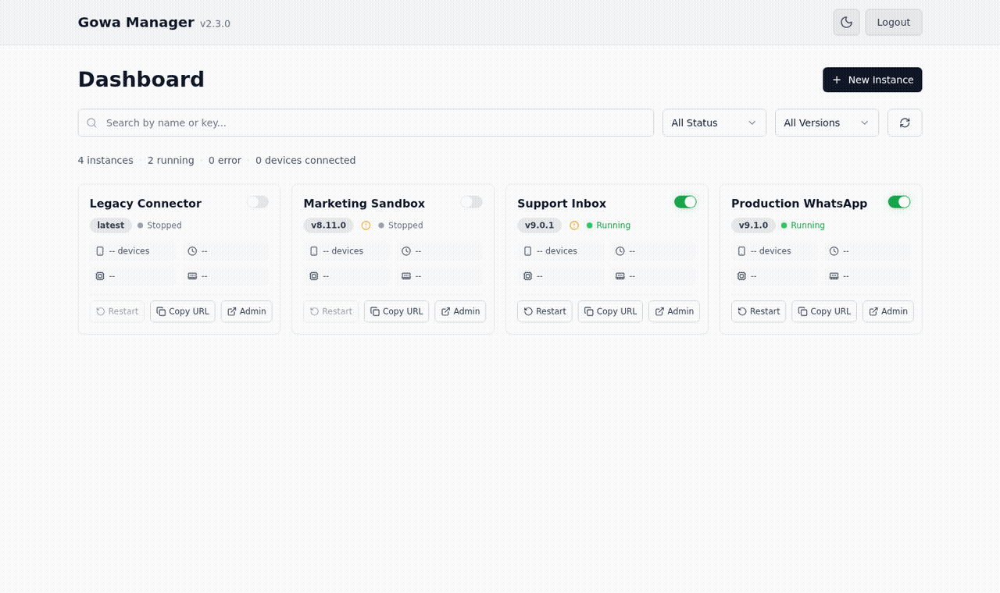

# GOWA Manager

**A full-stack web application for managing multiple GOWA (Go WhatsApp Web Multidevice) instances with version control, real-time monitoring, and advanced configuration options.**

This project is built on top of [go-whatsapp-web-multidevice](https://github.com/aldinokemal/go-whatsapp-web-multidevice) by **Aldino Kemal**.

> **Runtime status:** the Go backend is the current target runtime. The Bun/Elysia backend under `src/` is legacy and kept for compatibility/reference while remaining users migrate.

## Preview

Multi-instance dashboard with mixed versions and running/stopped status:


<details>
<summary>Watch a short multi-instance dashboard preview</summary>



</details>

## Features

- 🚀 **Multiple Instance Management** - Create, configure, and manage multiple GOWA instances
- 📦 **Version Control** - Install and use different GOWA versions per instance
- 🔄 **Real-time Monitoring** - Live status updates, resource usage, and uptime tracking
- ⚙️ **Advanced Configuration** - Comprehensive CLI flags and environment variable support
- 🔐 **User Management** - Multiple users, superadmin role, session login, and per-user API keys
- 🌐 **Proxy Integration** - Built-in proxy for accessing instance web interfaces
- 🔧 **Auto-restart Service** - Automatic instance recovery after server restarts
- 📊 **Resource Monitoring** - CPU and memory usage tracking with historical data
- 🎨 **Modern UI** - React-based interface with real-time updates

## Quick Start

### Using npx (Recommended)
```bash
npx gowa-manager
```
Automatically downloads the correct binary for your platform and runs it.

### Using Install Script
```bash
curl -fsSL https://raw.githubusercontent.com/fadlee/gowa-manager/main/install.sh | bash
```
Installs to `~/.local/bin/gowa-manager` and adds to PATH on Unix-like systems.

Note: for Windows, use `npx gowa-manager` or download the `.exe` release directly.

### Access the Application
Open http://localhost:3000 in your browser. On first start, register the first account (it becomes superadmin) using the setup token printed in the startup output.

<details>
<summary>Manual Binary Download</summary>

Download from [Releases](https://github.com/fadlee/gowa-manager/releases):

| Platform | Binary |
|----------|--------|
| Linux x64 | `gowa-manager-linux-amd64` |
| Linux ARM64 | `gowa-manager-linux-arm64` |
| Windows x64 | `gowa-manager-windows-amd64.exe` |

```bash
chmod +x gowa-manager-*
./gowa-manager-linux-amd64
```
</details>

<details>
<summary>Development Setup</summary>

```bash
# Clone the repository
git clone https://github.com/fadlee/gowa-manager.git
cd gowa-manager

# Install dependencies (server + client workspace)
bun install

# Run in development mode
bun run dev
```
</details>

## Version Management

GOWA Manager supports multiple GOWA versions, allowing you to:

### 🔄 **Automatic Version Management**
- **Auto-download**: Latest GOWA binary is automatically downloaded on first run
- **Version Storage**: Versions stored in `data/bin/versions/{version}/gowa`
- **Smart Caching**: Avoid re-downloading existing versions

### 📦 **Per-Instance Version Control**
- **Version Selection**: Choose specific GOWA version when creating instances
- **Version Editing**: Change version of existing instances (requires restart)
- **Mixed Versions**: Different instances can run different GOWA versions simultaneously

### 🛠 **Version Management API**
```bash
# List installed versions
GET /api/system/versions/installed

# List available versions from GitHub
GET /api/system/versions/available

# Install specific version
POST /api/system/versions/install
{"version": "v7.5.1"}

# Remove version
DELETE /api/system/versions/v7.5.1
```

### 📁 **Directory Structure**
```
data/
├── bin/
│   ├── versions/
│   │   ├── v7.5.1/gowa     # Specific version
│   │   ├── v7.5.0/gowa     # Another version
│   │   └── latest/         # Symlink to latest
│   └── gowa -> versions/latest/gowa  # Compatibility symlink
├── instances/              # Instance-specific data
└── gowa.db                # SQLite database
```

## Authentication & Users

### First run
When the database has no users, the Web UI shows a registration page. The
first account registered becomes the **superadmin**. Registration requires a
one-time **setup token** printed in the startup output, so nobody else can claim
a freshly exposed install:

```
  Setup:    No users yet. Open the Web UI to register the
            first superadmin with this setup token:
            9U-TIbHB9WrM8o__2c1F4pMq
```

Alternatively, seed the first superadmin non-interactively (only used while no
users exist; ignored afterwards):

```bash
ADMIN_USERNAME=admin ADMIN_PASSWORD=change-me gowa-manager
# or
gowa-manager --admin-username admin --admin-password change-me
```

There are no default credentials. Upgrading an existing install that set
`ADMIN_USERNAME`/`ADMIN_PASSWORD` turns those credentials into the superadmin
account automatically.

### Roles
- **superadmin** – everything, plus managing users (**Users** page).
- **user** – manages all instances and GOWA versions.

Superadmins create users (registration is closed after the first account), change
roles, reset passwords, disable or delete users. The last active superadmin cannot
be demoted, disabled, or deleted. Every user can change their own password from
**My account**; doing so signs out their other sessions.

### API keys
Each user can generate API keys on **My account**. A key is shown once, stored
only as a hash, and can be revoked at any time. A key has its owner's access,
but cannot manage users or API keys; it stops working if the owner is disabled
or deleted.

```bash
curl -H "Authorization: Bearer gowa_xxx" http://localhost:3000/api/instances
# or
curl -H "X-API-Key: gowa_xxx" http://localhost:3000/api/instances
```

HTTP Basic auth with a user's username and password also still works for
`/api/*`, for existing scripts.

### Sessions & limits
The Web UI uses an `HttpOnly`, `SameSite=Lax` session cookie valid for 30 days
(extended while in use). Failed logins are limited to 10 per 15 minutes per
client IP and username.

### Forgot password
```bash
gowa-manager reset-password <username> [--password <new>] [--data-dir <path>]
```
Without `--password`, a random password is generated and printed. All of the
user's sessions are signed out.

## Proxy Access And Security

GOWA Manager exposes running instances through proxy paths such as `/app/{instanceKey}/...`.

Important behavior:
- Manager authentication (session, API key, or user Basic auth) protects manager APIs like `/api/instances` and `/api/system`.
- Proxy routes under `/app/{instanceKey}/...` do not require manager authentication.
- Proxy protection is delegated to each GOWA instance, so enable instance `basicAuth` when the proxy is reachable by untrusted clients.
- External clients and webhooks can call proxied GOWA APIs without knowing manager admin credentials, but they should send the GOWA instance credentials when required.

Example proxied API call:
```bash
curl \
  -H "Authorization: Basic $(printf 'admin:admin123' | base64)" \
  http://localhost:3000/app/ABC12345/app/devices
```

### WebSocket Auth Injection

Browsers cannot set custom `Authorization` headers when creating a native `WebSocket`. To keep proxied GOWA multi-device pages working, the WebSocket proxy injects the first configured instance Basic Auth pair from `config.flags.basicAuth[0]` when the incoming WebSocket request has no `Authorization` header.

Security notes:
- This is enabled by default.
- Anyone who can reach a proxied WebSocket URL for an instance can use the manager-injected upstream credential for that WebSocket connection.
- Disable this behavior for stricter public deployments and require external clients to provide GOWA auth themselves.

```bash
PROXY_WS_INJECT_INSTANCE_AUTH=false
```

## Instance Management

### Creating Instances
1. **Via Web UI**: Click "Create New Instance" button
2. **Select Version**: Choose from installed versions or install new ones
3. **Configure Settings**: Optional advanced configuration (collapsed by default)
4. **Auto-allocation**: Ports and directories automatically managed

### Instance Features
- ✅ **Lifecycle Management** - Start, stop, restart instances
- 📊 **Real-time Status** - Live monitoring with resource usage
- 🔧 **Configuration Editor** - Modify settings anytime
- 📦 **Version Switching** - Change GOWA version per instance
- 🌐 **Web Access** - Direct proxy links to instance UIs
- 🗑️ **Safe Deletion** - Cleanup processes and data

## Development Commands

### Go Backend Development (Current)
```bash
# Run the Go backend with a separate data directory
bun run dev:go -- --data-dir .contract-tmp/go-dev --port 39000

# Run Go tests
bun run test:go

# Build the Go binary with embedded frontend assets
bun run build:go
```

### Legacy Bun/Elysia Development
```bash
# Legacy single-port development with auto-rebuild
bun run dev
```

This legacy runner:
- runs `vite build --watch` inside `client/`
- runs `bun --watch run src/index.ts` for the legacy Elysia server
- serves the built frontend from `http://localhost:3000`

### Separate Development
```bash
# Legacy Bun/Elysia server only (with auto-restart)
bun run dev:server

# Client only (Vite dev server on :5173)
bun run dev:client
```

### Legacy Bun/Elysia Backend

The Bun/Elysia backend is legacy. Keep it available for compatibility checks and rollback/reference work, but new backend behavior should target the Go implementation unless explicitly requested otherwise.

#### Go Backend Operator Runbooks

For production deployment, cutover, and rollback of the Go backend, see the
operator runbooks:

- [docs/GO_BACKEND_OPERATIONS.md](docs/GO_BACKEND_OPERATIONS.md) — Normal
  operation (Linux/Docker/Windows setup, monitoring, backups, troubleshooting)
- [docs/GO_BACKEND_CANARY.md](docs/GO_BACKEND_CANARY.md) — Canary cutover
  from Bun to Go (step-by-step)
- [docs/GO_BACKEND_ROLLBACK.md](docs/GO_BACKEND_ROLLBACK.md) — Rollback from
  Go to Bun (triggers, commands, verification)

### Testing And Validation
```bash
# Run backend/unit/integration tests
bun run test

# Typecheck backend TypeScript
bun run build:tsc

# Recommended pre-commit validation
bun run test && bun run build:tsc
```

Tests use an isolated `.test-data/bun-<pid>` directory via `test/setup.ts`, so DB-backed tests do not touch the runtime `data/gowa.db`.

### Production Build
```bash
# Build the current Go binary with embedded frontend assets
bun run build:go

# Legacy Bun/Elysia production build and standalone binary
bun run build:production
bun run compile
```

### Build Helpers
```bash
# Generate src/version.ts from git metadata
bun run generate-version

# Build client only
bun run build:client

# Embed built client assets into the server source
bun run embed-static
```

## Configuration

### Environment Variables
```env
# Initial superadmin (optional; only used while no users exist)
ADMIN_USERNAME=admin
ADMIN_PASSWORD=change-me

# Secret for magic admin links (optional; default: random, stored in the DB)
ADMIN_LINK_SECRET=

# Data directory (optional)
DATA_DIR=./data

# Comma-separated browser origins allowed in production CORS (optional)
CORS_ALLOWED_ORIGINS=https://manager.example.com,https://admin.example.com

# Disable default WebSocket Basic Auth injection from instance config (optional)
PROXY_WS_INJECT_INSTANCE_AUTH=false
```

### CLI Options
```bash
# Current Go backend
bun run dev:go -- --data-dir /path/to/data
bun run dev:go -- --port 8080
bun run dev:go -- --admin-username admin --admin-password pass   # seed first superadmin
bun run dev:go -- reset-password admin

# Legacy Bun/Elysia backend
bun run src/index.ts --data-dir /path/to/data
bun run src/index.ts --port 8080
bun run src/index.ts --admin-username admin --admin-password pass
```

## API Reference

OpenAPI docs tersedia di:

```bash
GET /openapi
```

### Instance Management
```bash
# List all instances
GET /api/instances

# Create new instance
POST /api/instances
{
  "name": "my-instance",
  "gowa_version": "latest",
  "config": "{...}"
}

# Update instance
PUT /api/instances/{id}
{
  "name": "updated-name",
  "gowa_version": "v7.5.1",
  "config": "{...}"
}

# Instance actions
POST /api/instances/{id}/start
POST /api/instances/{id}/stop
POST /api/instances/{id}/restart

# Get instance status
GET /api/instances/{id}/status

# Get recent Go-managed stdout/stderr logs
GET /api/instances/{id}/logs?tail=200

# Read-only instance files
GET /api/instances/{id}/files?path=logs
GET /api/instances/{id}/files/preview?path=logs/app.log
GET /api/instances/{id}/files/download?path=logs/app.log
```

### Version Management
```bash
# List installed versions
GET /api/system/versions/installed

# List available versions
GET /api/system/versions/available?limit=10

# Install version
POST /api/system/versions/install
{"version": "v7.5.1"}

# Remove version
DELETE /api/system/versions/{version}

# Check version availability
GET /api/system/versions/{version}/available

# Get disk usage
GET /api/system/versions/usage

# Cleanup old versions
POST /api/system/versions/cleanup
{"keepCount": 3}
```

### System Information
```bash
# System status
GET /api/system/status

# Configuration
GET /api/system/config

# Port management
GET /api/system/ports/next
GET /api/system/ports/{port}/available
```

## Architecture

### Modular Backend Structure
```
src/
├── modules/
│   ├── instances/        # Instance lifecycle management
│   │   ├── service.ts   # Business logic
│   │   ├── model.ts     # API schemas
│   │   └── utils/       # Process, directory, config management
│   ├── system/          # System status, ports, versions
│   │   ├── service.ts   # System operations
│   │   ├── versions.ts  # Version management API
│   │   └── version-manager.ts  # Version business logic
│   ├── proxy/           # Request proxying with WebSocket support
│   └── auth/            # Authentication middleware
├── middlewares/         # Reusable middleware
├── types/              # TypeScript definitions
├── db.ts               # SQLite database with prepared statements
└── binary-download.ts  # Auto-download service
```

### Frontend Architecture
```
client/src/
├── components/
│   ├── VersionSelector.tsx    # Version management UI
│   ├── CreateInstanceDialog.tsx
│   ├── EditInstanceDialog.tsx
│   ├── InstanceCard.tsx
│   └── ui/                    # UI components
├── lib/
│   ├── api.ts                # API client
│   └── auth.tsx              # Authentication context
└── types/                    # TypeScript definitions
```

### Data Flow
1. **SQLite Database** stores instance metadata and configuration
2. **Go HTTP API** handles runtime operations, process management, proxying, and instance file access
3. **React Frontend** communicates via REST API with real-time updates
4. **Legacy Bun/Elysia Backend** remains under `src/` for compatibility/reference
5. **Version Manager** handles multiple GOWA binary versions
6. **Proxy Module** forwards requests to running instances
7. **Auto-restart Service** maintains instance state across server restarts

## Troubleshooting

### Common Issues

**🔧 Instance Won't Start**
```bash
# Check if version is installed
GET /api/system/versions/{version}/available

# Install missing version
POST /api/system/versions/install {"version": "v7.5.1"}

# Check port availability
GET /api/system/ports/{port}/available
```

**📦 Version Installation Fails**
- Check internet connection
- Verify GitHub access (not behind firewall)
- Ensure sufficient disk space
- Check file permissions in data directory

**🔄 Version Change Not Applied**
- Version changes require instance restart
- Stop and start the instance after changing version
- Check instance logs for errors

**🗃️ Database Issues**
```bash
# Reset database (⚠️ deletes all data)
bun run reset-db

# Or manually delete
rm data/gowa.db
```

**🌐 Proxy/Web UI Issues**
- Ensure instance is running and healthy
- Check proxy path: `/app/{instanceKey}/`
- Verify instance port allocation

### Logs and Debugging
```bash
# Enable debug mode
DEBUG=1 bun run dev

# Check server logs
bun run dev:server

# Test API endpoints
curl http://localhost:3000/api/health
curl http://localhost:3000/api/instances
```

### File Permissions
```bash
# Fix binary permissions
chmod +x data/bin/versions/*/gowa

# Fix data directory permissions
chmod -R 755 data/
```

## Contributing

1. **Fork the repository**
2. **Create feature branch**: `git checkout -b feature/amazing-feature`
3. **Follow existing code patterns**; target Go for backend changes and TypeScript for frontend changes
4. **Test your changes**: `bun run test:go` for Go backend work, `bun run build:tsc` / `cd client && bun run build` for frontend work
5. **Update documentation** if needed
6. **Submit pull request**

### Development Guidelines
- Use **prepared statements** for database queries
- Follow **modular architecture** patterns
- Add **comprehensive error handling**
- Include **TypeScript types** for all APIs
- Test both **frontend and backend** changes

## Credits

- [go-whatsapp-web-multidevice](https://github.com/aldinokemal/go-whatsapp-web-multidevice) by **Aldino Kemal** - The core WhatsApp Web multidevice binary that powers this manager

## License

This project is licensed under the MIT License - see the [LICENSE](LICENSE) file for details.

## Support

- **Issues**: Report bugs and feature requests via GitHub Issues
- **Documentation**: See `/docs` directory for detailed guides
  - [Go Backend Operations](docs/GO_BACKEND_OPERATIONS.md) — Production operation runbook
  - [Go Backend Canary Cutover](docs/GO_BACKEND_CANARY.md) — Bun-to-Go cutover procedure
  - [Go Backend Rollback](docs/GO_BACKEND_ROLLBACK.md) — Go-to-Bun rollback procedure
- **API**: Full OpenAPI documentation available at `/openapi` (when running)

---

**Built with**: [Go](https://go.dev) • [React](https://react.dev) • [TypeScript](https://typescriptlang.org) • [Bun](https://bun.sh) tooling • [TailwindCSS](https://tailwindcss.com) • legacy [Elysia](https://elysiajs.com) backend
