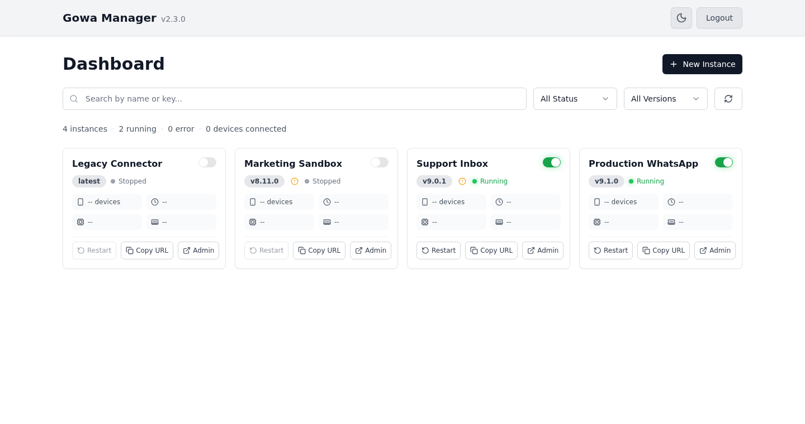

# GOWA Manager

**Run and manage many [GOWA](https://github.com/aldinokemal/go-whatsapp-web-multidevice) (Go WhatsApp Web Multidevice) instances from one web dashboard.**

GOWA Manager is a single binary (or Docker image). It downloads GOWA for you, starts and stops instances, lets each instance use its own GOWA version, and gives each one a stable URL behind one port.



## Features

- **Many instances:** create, start, stop, and restart GOWA instances from the Web UI or the API.
- **Version control:** install several GOWA versions and pick one per instance.
- **One port for everything:** each instance is reachable at `/app/<instance-key>/`. You do not need to open extra ports.
- **Monitoring:** live status, CPU and memory use, and logs per instance.
- **Auto-restart:** instances that were running come back after the manager restarts.
- **Users and API keys:** several users, a superadmin role, and per-user API keys for scripts.

## Quick start with Docker (recommended)

```bash
docker run -d --name gowa-manager \
  -p 3000:3000 \
  -v gowa-data:/app/data \
  --restart unless-stopped \
  fadlee/gowa-manager:latest
```

The image is also published as `ghcr.io/fadlee/gowa-manager`.

> **Keep your data:** everything is stored in **`/app/data`** inside the container. Always mount a volume or a host folder there (for example `-v /srv/gowa-manager:/app/data`). Without it, you lose all instances and WhatsApp sessions when the container is recreated.

Then open http://localhost:3000 and [create the first account](#first-login).

### Docker Compose

```yaml
services:
  gowa-manager:
    image: fadlee/gowa-manager:latest
    container_name: gowa-manager
    restart: unless-stopped
    ports:
      - "3000:3000"
    volumes:
      - ./data:/app/data
    environment:
      TZ: Asia/Jakarta
      # Optional: create the first superadmin automatically.
      # ADMIN_USERNAME: admin
      # ADMIN_PASSWORD: change-me-please
```

```bash
docker compose up -d
```

With `./data:/app/data`, the data is in a `data` folder next to `docker-compose.yml`. The container runs as a non-root user and fixes the folder's ownership on start, so you do not need to `chown` it yourself.

## Quick start without Docker

**npx** (Linux, macOS, Windows; needs Node.js):

```bash
npx gowa-manager --data-dir ~/gowa-data
```

**Install script** (Linux, macOS; installs to `~/.local/bin/gowa-manager`):

```bash
curl -fsSL https://raw.githubusercontent.com/fadlee/gowa-manager/main/install.sh | bash
gowa-manager --data-dir ~/gowa-data
```

**Manual download:** get the binary for your platform from [Releases](https://github.com/fadlee/gowa-manager/releases) (`linux-amd64`, `linux-arm64`, `macos-amd64`, `macos-arm64`, `windows-amd64.exe`).

> **Where is my data?** Without `--data-dir`, data goes to **`./data` in the folder where you run the command**. If you later start it from another folder, the manager will not find your instances. Always pass `--data-dir` with a fixed path, or set `DATA_DIR`.

The binary listens on `127.0.0.1:3000` by default. Use `--host 0.0.0.0` to accept connections from other machines.

## First login

There are no default credentials. On the first start, the manager prints a one-time **setup token**:

```
  Setup:    No users yet. Open the Web UI to register the
            first superadmin with this setup token:
            9U-TIbHB9WrM8o__2c1F4pMq
```

Open the Web UI, enter the token, and choose a username and password. This first account is the **superadmin**. With Docker, read the token with `docker logs gowa-manager`.

To skip this step, set `ADMIN_USERNAME` and `ADMIN_PASSWORD` (or `-u` / `-P`). They create the first superadmin, and they are ignored after any user exists.

Forgot your password? Run:

```bash
gowa-manager reset-password <username> --data-dir <your data dir>
# Docker:
docker exec -it -u app gowa-manager ./gowa-manager reset-password <username>
```

More about users, roles, and API keys: [docs/AUTHENTICATION.md](docs/AUTHENTICATION.md).

## Configuration

| Environment variable | Flag | Default | Description |
|---|---|---|---|
| `PORT` | `-p, --port` | `3000` | HTTP port. |
| `HOST` | `--host` | `127.0.0.1` (Docker: `0.0.0.0`) | Address to listen on. |
| `DATA_DIR` | `-d, --data-dir` | `./data` (Docker: `/app/data`) | Folder for all persistent data. |
| `ADMIN_USERNAME` | `-u, --admin-username` | none | First superadmin. Used only while no users exist. |
| `ADMIN_PASSWORD` | `-P, --admin-password` | none | Password for that superadmin. |
| `ADMIN_LINK_SECRET` | | random, stored in the database | Secret that signs instance admin links. |
| `GOWA_SKIP_STARTUP_INSTALL` | | `0` | `1` skips downloading the latest GOWA on start. |
| `GOWA_VERBOSE` | `--verbose` | `0` | `1` turns on detailed logs. |
| `GOWA_METRICS_ENABLED` | | `0` | `1` enables Prometheus metrics at `/metrics` (loopback only). |

Flags take precedence over environment variables. Run `gowa-manager --help` for the full list.

## Data and backups

Everything the manager needs is in the data directory:

```
<data dir>/
├── gowa.db               # SQLite database: instances, users, settings
├── bin/versions/<ver>/   # Downloaded GOWA binaries
├── instances/<id>/       # Per-instance data, including WhatsApp sessions
└── .gowa-manager.lock    # Prevents two managers from using the same folder
```

To back up, stop the manager and copy the whole folder. Only one manager can use a data directory at a time. See [docs/GO_BACKEND_OPERATIONS.md](docs/GO_BACKEND_OPERATIONS.md) for backup scripts and other operations tasks.

## Reaching your instances

Each running instance is available at `http://<manager>/app/<instance-key>/`. The manager login protects the dashboard and `/api/*`, but **not** the `/app/...` proxy paths. Those paths are protected by each instance's own GOWA Basic Auth. If the manager is reachable from the internet, set Basic Auth on every instance.

```bash
curl -u gowa-user:gowa-pass http://localhost:3000/app/ABC12345/app/devices
```

> **GOWA v9.8.0 and newer refuse to start without Basic Auth.** If an instance stops a few seconds after you start it, open the instance settings and add a Basic Auth username and password. The reason is shown on the instance card and in the manager log.

## Upgrading

- **Docker:** `docker pull fadlee/gowa-manager:latest`, then recreate the container with the same volume.
- **npx:** downloads the newest release on start.
- **Binary:** download the new binary and replace the old one.

Read the [release notes](https://github.com/fadlee/gowa-manager/releases) before a major upgrade. Upgrading from v2 to v3: if you set `ADMIN_USERNAME` / `ADMIN_PASSWORD`, that account becomes the superadmin. If you used the old default `admin` / `password`, register the first account with the setup token after upgrading.

## Documentation

- [Authentication, users, and API keys](docs/AUTHENTICATION.md)
- [API reference](docs/API.md)
- [Operations runbook](docs/GO_BACKEND_OPERATIONS.md): Linux service, Docker, Windows, monitoring, backups, troubleshooting
- [GOWA version management](docs/VERSION_MANAGEMENT.md)
- [Development and contributing](docs/DEVELOPMENT.md)

## Credits

Built on [go-whatsapp-web-multidevice](https://github.com/aldinokemal/go-whatsapp-web-multidevice) by **Aldino Kemal**, the WhatsApp Web multidevice binary that this manager runs.

## License

MIT.
