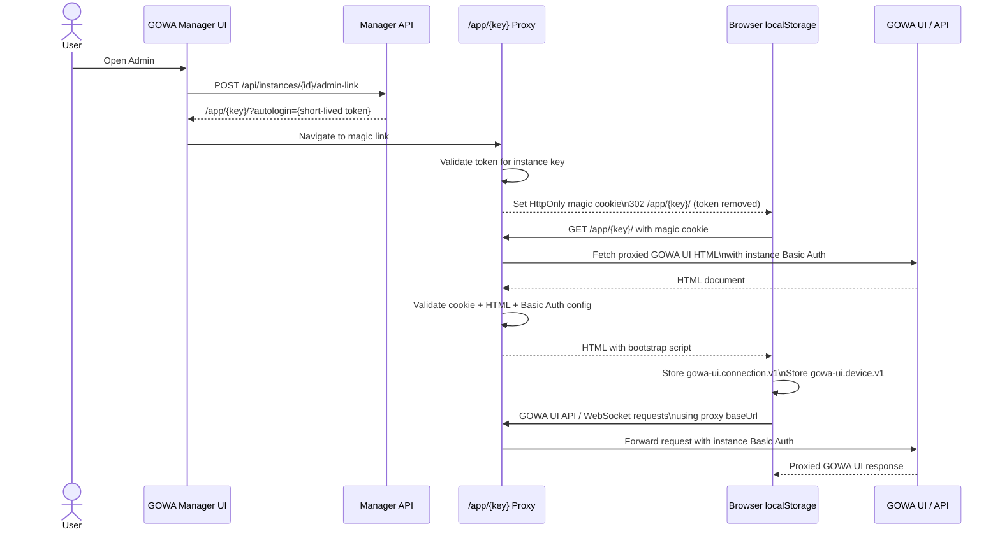

# GOWA UI LocalStorage Auto-Login Design

## Goal

Restore one-click admin access for new GOWA UI releases, which persist their connection configuration in browser `localStorage` instead of relying only on HTTP Basic Auth challenges.

## Context

The manager currently issues a short-lived `/app/{key}/?autologin={token}` link. A valid token creates an HTTP-only, instance-scoped magic-admin cookie and redirects to the same URL without the token. The proxy then injects the instance's Basic Auth header into upstream HTTP and WebSocket requests only while that cookie is valid.

New GOWA UI reads the following persisted Zustand state before making its requests:

- `gowa-ui.connection.v1`: `{ "state": { "baseUrl", "username", "password" }, "version": 0 }`
- `gowa-ui.device.v1`: `{ "state": { "selectedDeviceId": "default" }, "version": 0 }`

With an empty connection state, GOWA UI shows its connection screen. With an upstream loopback `baseUrl`, browser requests bypass the manager proxy altogether. Header injection alone therefore cannot establish a GOWA UI connection.

## Architecture

When an authenticated magic-admin session requests the proxied GOWA UI HTML document, the Go reverse proxy buffers that HTML response and injects a small inline bootstrap script before the first module script executes.

The bootstrap script writes the two required localStorage entries on the manager origin:

```json
{
  "state": {
    "baseUrl": "<manager-origin>/app/<instance-key>",
    "username": "<instance-basic-auth-username>",
    "password": "<instance-basic-auth-password>"
  },
  "version": 0
}
```

```json
{
  "state": { "selectedDeviceId": "default" },
  "version": 0
}
```

The proxy-derived base URL ensures browser HTTP and WebSocket traffic remains under `/app/{key}/`, where existing proxy behavior, magic-cookie authentication, header injection, URL rewriting, and upstream cookie scoping apply.

## Flow Visualization



```mermaid
flowchart TD
    Start[Open /app/{key}/?autologin=token] --> ValidToken{Token valid?}
    ValidToken -- No --> Reject[401 and clear magic cookie]
    ValidToken -- Yes --> Cookie[Set instance-scoped HttpOnly cookie]
    Cookie --> Redirect[302 to URL without token]
    Redirect --> HTML{Response is GOWA UI HTML?}
    HTML -- No --> Original[Forward response unchanged]
    HTML -- Yes --> Session{Valid magic cookie and Basic Auth config?}
    Session -- No --> Unchanged[Return original HTML without credentials]
    Session -- Yes --> Inject[Inject bootstrap script]
    Inject --> Store[Write proxy baseUrl, username, password, default device to localStorage]
    Store --> Ready[GOWA UI is connected through /app/{key} proxy]
```

## Backward Compatibility

The feature is version-agnostic and additive; it must not branch on a GOWA version string.

- The existing magic-cookie flow and proxy-side Basic Auth injection remain unchanged. They continue to authorize HTTP and WebSocket traffic for all supported GOWA versions.
- Older GOWA UIs that do not read `gowa-ui.connection.v1` or `gowa-ui.device.v1` ignore the additional localStorage entries and continue using the proxy's injected Authorization header.
- New GOWA UI releases read the injected entries and use the manager proxy URL as their connection base.
- Requests that are not eligible for injection, including non-HTML responses and ordinary proxy visits without a valid magic cookie, retain their prior byte-for-byte response handling.
- If future GOWA UI releases change their state-key schema, the old proxy authentication path remains available; the only degraded behavior is the return of GOWA UI's manual connection form rather than failed proxy access.

### Compatibility Test Matrix

| Scenario | HTML bootstrap | Proxy Basic Auth injection | Expected result |
| --- | --- | --- | --- |
| Older GOWA UI + valid magic cookie | Present but ignored by UI | Active | Existing one-click admin access continues |
| New GOWA UI + valid magic cookie | Present and consumed | Active | GOWA UI opens connected to `/app/{key}` |
| Any UI + normal proxy visit | Absent | Absent unless client sends Authorization | No credentials exposed; existing normal behavior |
| Any UI + invalid or expired magic link | Absent | Absent | Existing 401 and cleared cookie behavior |
| Instance without Basic Auth | Absent | Absent | Existing unauthenticated proxy behavior |

## Request Eligibility

Injection is allowed only when every condition is true:

1. The response is HTML.
2. The request is for the proxied instance's UI document (not an API or static asset response).
3. The request carries a currently valid magic-admin cookie for that exact instance key.
4. The instance configuration contains a non-empty first `flags.basicAuth` username and password.

A normal proxy visit, an invalid or expired magic cookie, or an instance without Basic Auth receives the original HTML unchanged. The autologin query parameter remains removed by the existing redirect flow and is never placed in HTML, JavaScript URLs, logs, or responses other than the initial manager API result.

## Security Constraints

- The browser must receive the Basic Auth password because GOWA UI explicitly requires it in localStorage. This is an intentional, user-approved compatibility trade-off.
- The password is never added to the magic-link query, response headers, logs, manager API payloads, or HTML for unauthenticated proxy requests.
- The existing magic cookie remains `HttpOnly`, instance-scoped, and short-lived; JavaScript cannot read it.
- The injected script must serialize all dynamic values with `json.Marshal` rather than string concatenation so values cannot break out of JavaScript string literals.
- The bootstrap runs only on the manager's origin. Browser same-origin policy prevents it from writing state for an upstream loopback origin.

## Components

### `internal/proxy`

- Add a focused helper that identifies eligible HTML responses and safely injects the localStorage bootstrap into the `<head>` (or immediately after `<head>` if present).
- Extend `HTTPProxy` response rewriting with the current instance, request URL, and magic-auth context needed to decide injection.
- Reuse parsed instance configuration or add a focused credential helper returning raw username/password only inside the proxy package. Do not expose credentials through HTTP APIs.
- Preserve the existing JSON URL rewrite and streaming behavior for all non-HTML responses. HTML is intentionally buffered only for eligible injection.

### Tests

- Unit-test the injection helper for exact state keys, proxy-origin base URL, escaping of credentials, document insertion, and non-HTML/no-head behavior.
- Extend HTTP proxy tests to establish a valid magic cookie and verify injected HTML, then cover normal/invalid-cookie/no-credentials paths returning unchanged HTML.
- Keep existing cookie, Authorization-header precedence, JSON rewriting, and WebSocket tests passing.

## Error Handling

If the HTML body cannot be read or the injection helper cannot produce a safe document, the proxy returns the upstream body unchanged rather than blocking admin access. A missing or malformed instance Basic Auth configuration simply disables localStorage injection; it must not expose an error containing configuration values.

## Verification

Run focused Go proxy tests first, then the full Go test suite. Run the production build/type-check commands appropriate to the Go migration state only if the repository's current CI scripts still use them. Manually verify in a browser that opening an admin link stores both entries under the manager origin and that GOWA UI loads without showing its connection form.
